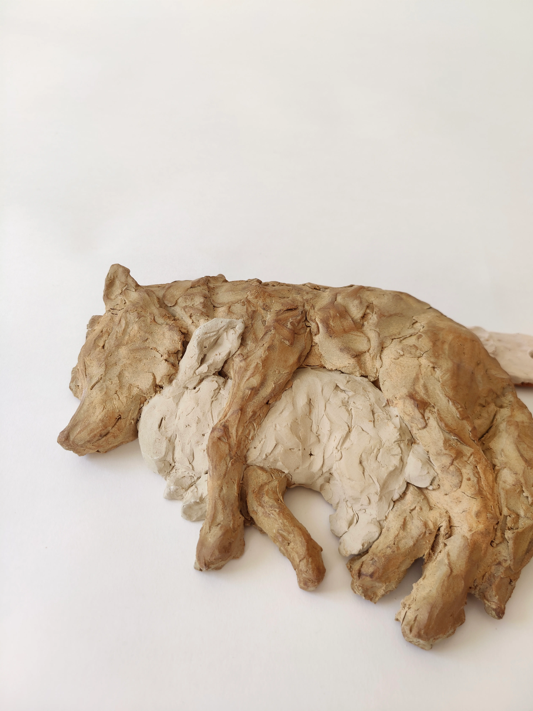
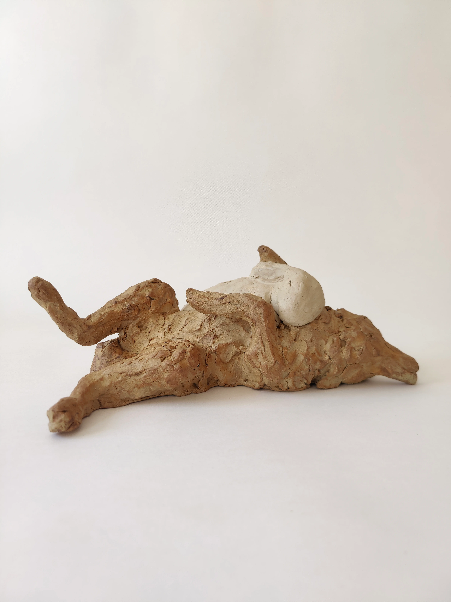
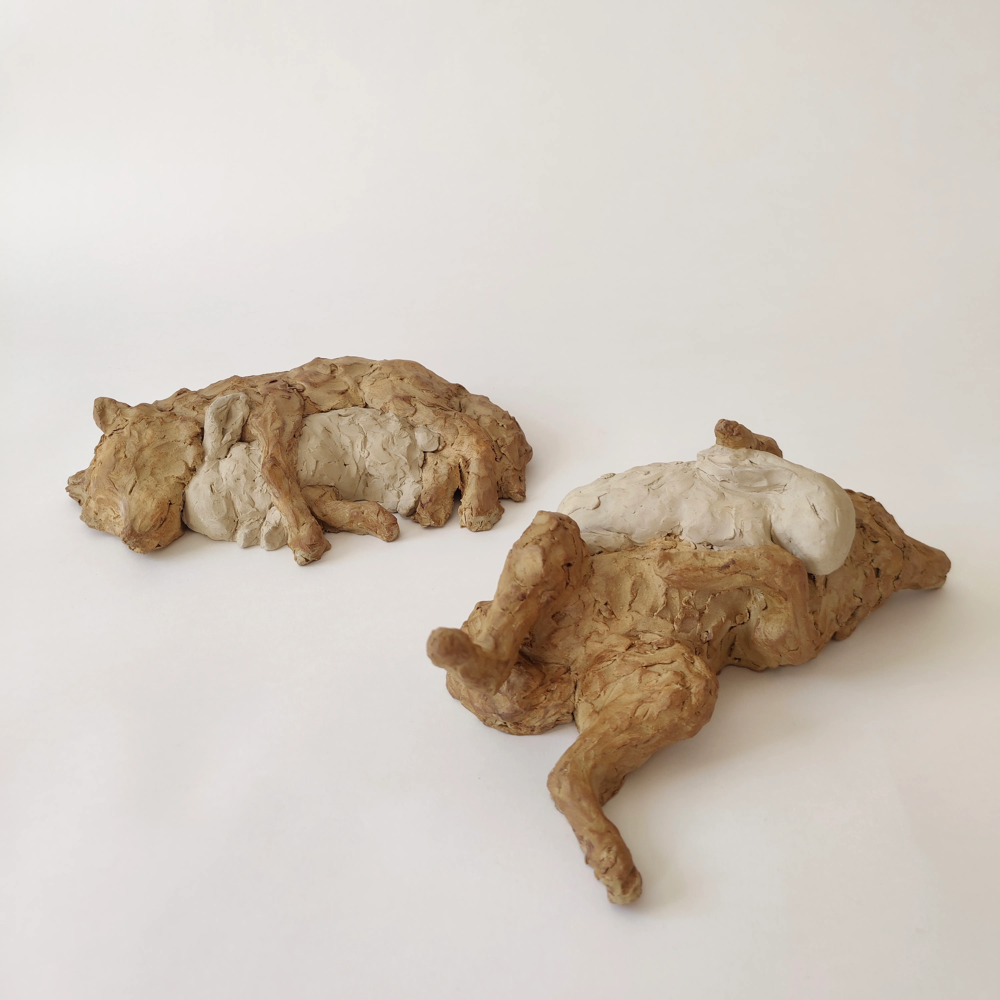
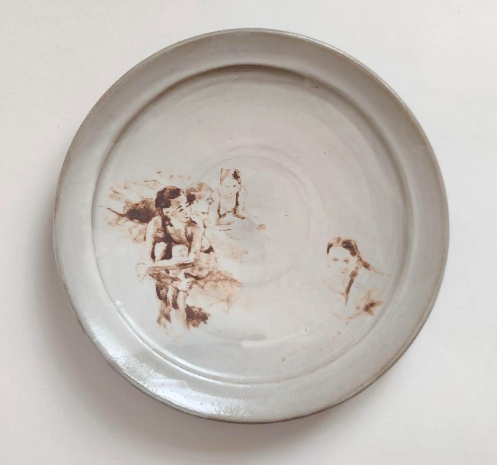
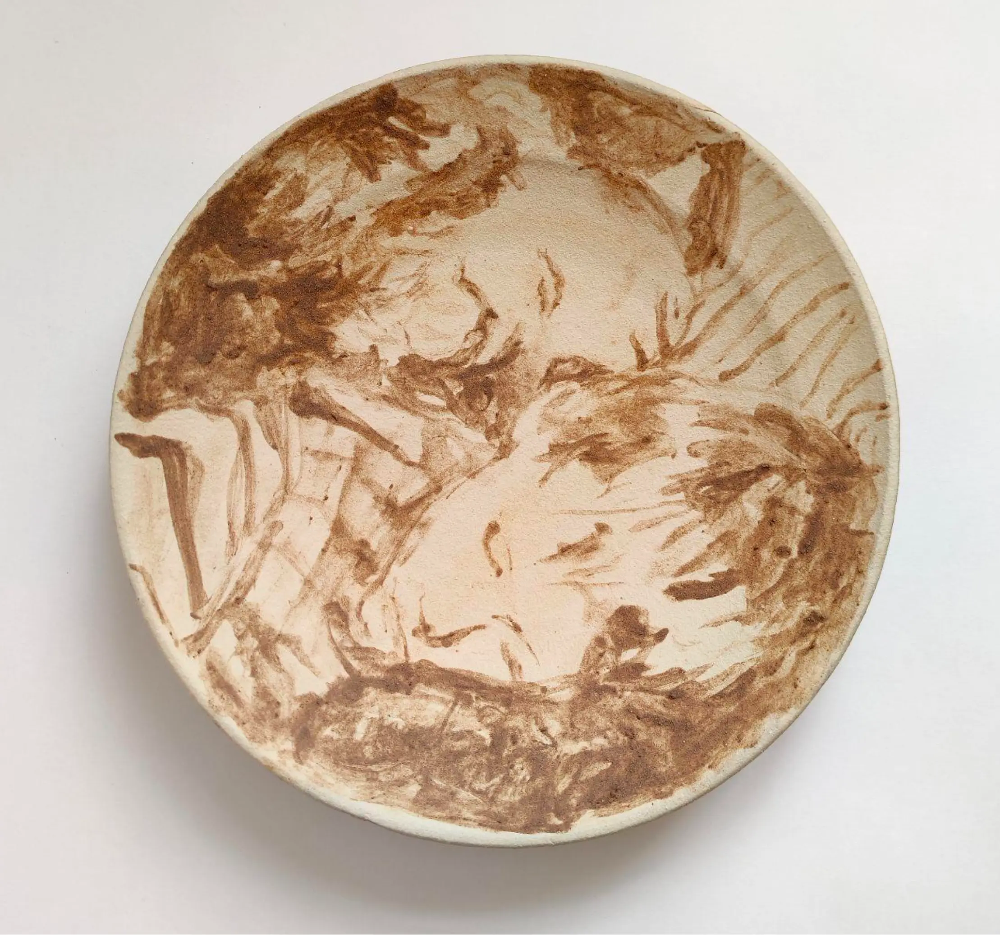
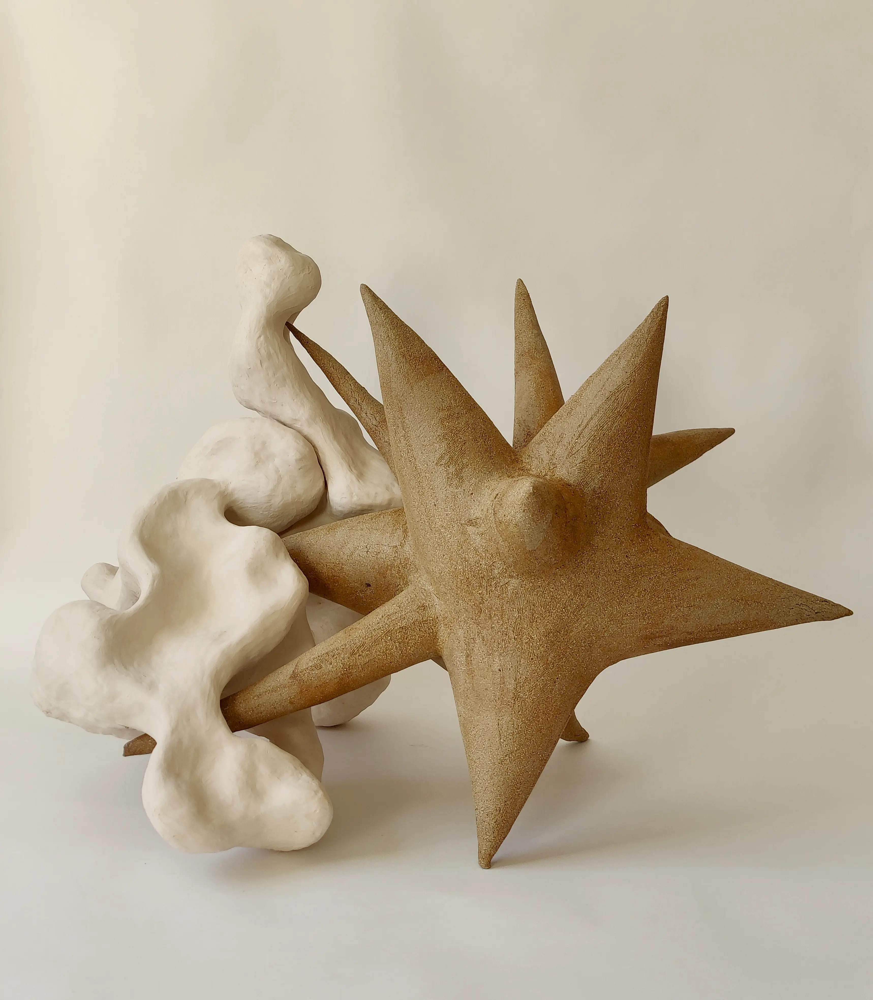

<!-- STYLING RULES FOR ALL PHOTO GRIDS -->

<!-- ========================================== -->
<!-- SECTION ONE: THE ASYMMETRICAL TRIO         -->
<!-- ========================================== -->

  <!-- Bottom Pair (6x8 Dimensions) -->
  

    

      
    

    

      
    

  

  
  <!-- Top Main Focal Photo (Different Dimensions) -->
  

    
  

  
  
Tillit

<!-- THIN SEPARATOR LINE -->

<!-- ========================================== -->
<!-- SECTION TWO: THE GALLERY DUO (SQUARES)     -->
<!-- ========================================== -->

  

    

      
    

    

      
    

  

  
  
Fotominnen

<!-- THIN SEPARATOR LINE -->

 

    
  

  
Jag menade inte att såra dig

