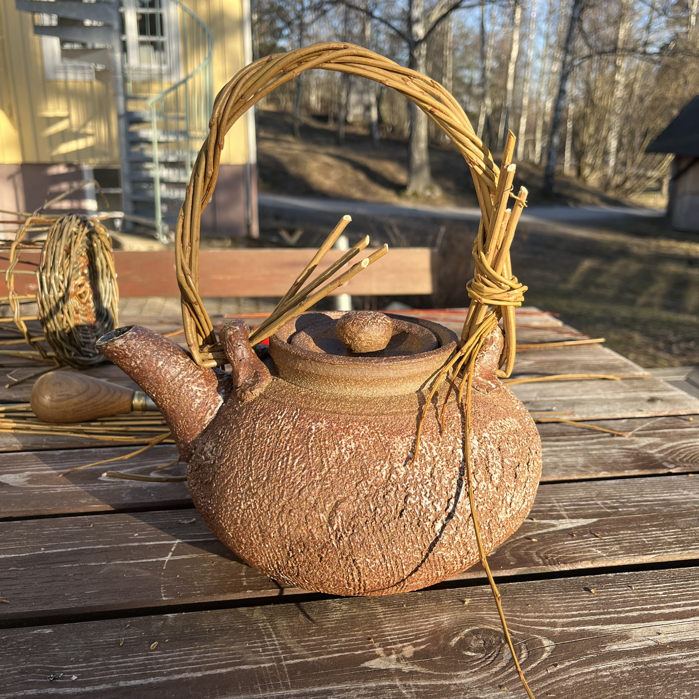
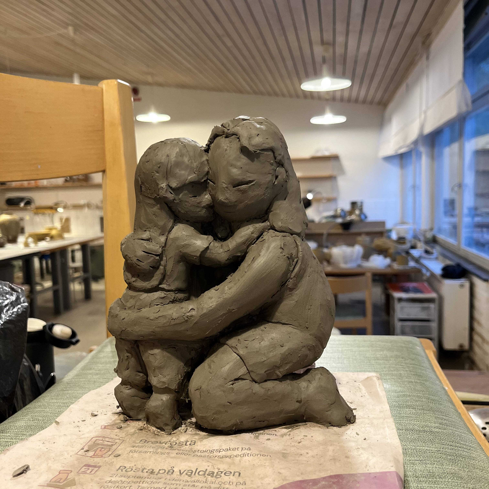
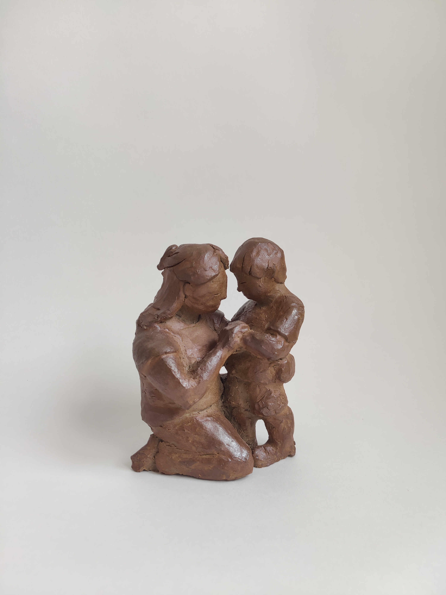
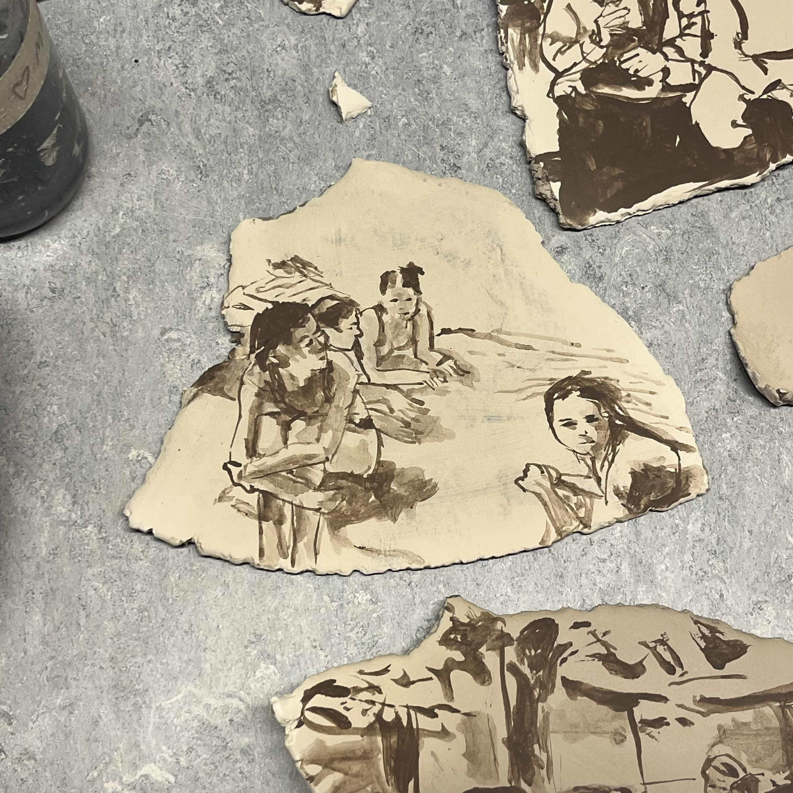
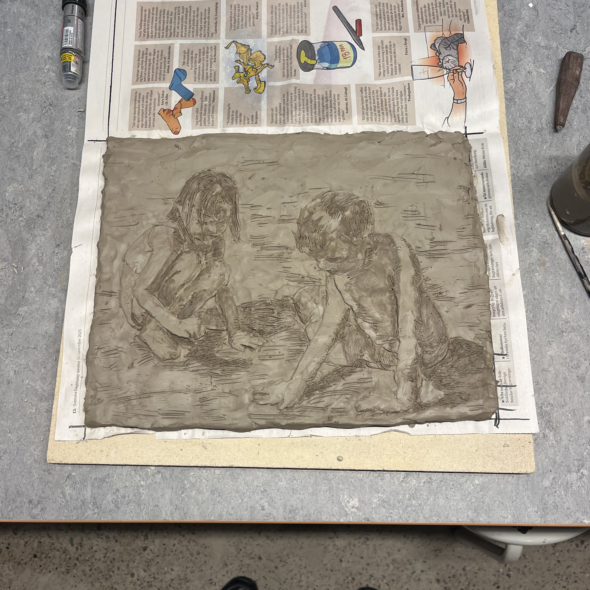

<!-- BULLETPROOF SIDE-BY-SIDE GRID (SQUARES PERFECTLY ALIGNED) -->

  
  <!-- LEFT SIDE: SQUARE VIDEO (HOVER TO PLAY, NO ZOOM, NO SOUND) -->
  

    <video 
      src="tek2.MOV" 
      muted 
      loop 
      playsinline
      style="width: 100%; aspect-ratio: 1 / 1; object-fit: cover; display: block; cursor: pointer; margin: 0;" 
      onmouseover="this.play();" 
      onmouseout="this.pause();"
      onclick="this.paused ? this.play() : this.pause();">
    </video>
  

  <!-- RIGHT SIDE: SQUARE IMAGE (SMOOTH HOVER ZOOM) -->
  

    
  

<!-- SHARED LIGHT-GRAY CAPTION -->

Tekanna-experiment

  

  

Skulpturskisser

<!-- BULLETPROOF SIDE-BY-SIDE GRID (SQUARES PERFECTLY ALIGNED) -->

  
  <!-- LEFT SIDE: SQUARE VIDEO (HOVER TO PLAY, NO ZOOM, NO SOUND) -->
 

    
  

  <!-- RIGHT SIDE: SQUARE IMAGE (SMOOTH HOVER ZOOM) -->
  

    
  

<!-- SHARED LIGHT-GRAY CAPTION -->

Att teckna med lera

